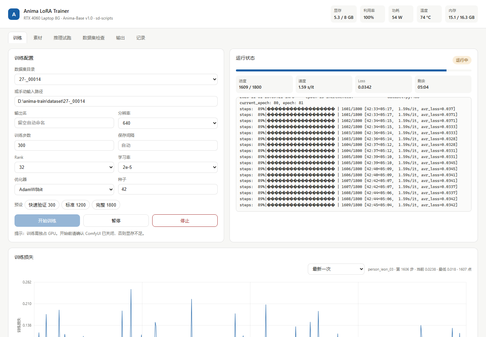
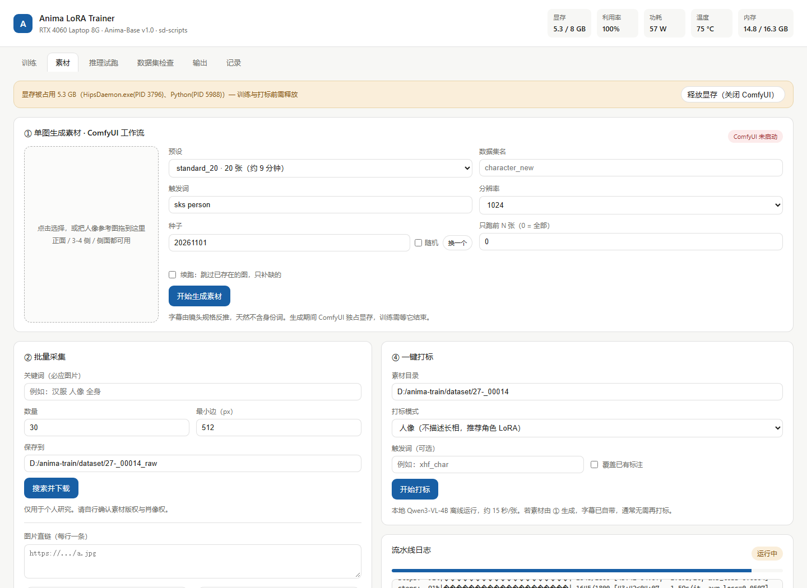
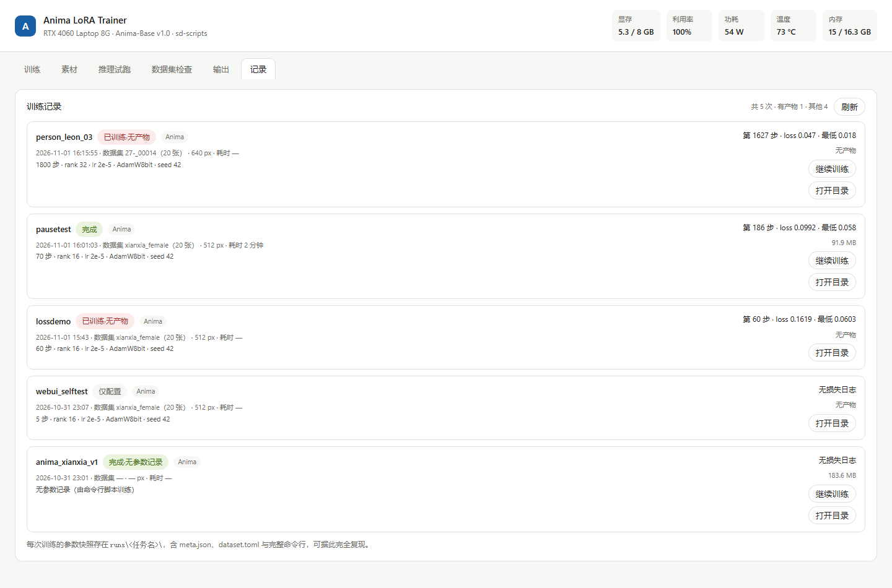

# Anima LoRA Trainer

> 一条从「素材」到「LoRA」的本地训练流水线：单图生成素材 → 清洗打标 → 训练 → 实时损失曲线 → 暂停续训 → 推理验证。
> 面向低显存（8 GB）Windows 机器，后端只依赖 Python 标准库，前端零框架。

这不是又一个训练 GUI 外壳。它把「凑素材 → 洗数据 → 训 → 验证」这条链路上踩过的坑固化成了界面上的默认值：

- 打标提示词默认**不描述长相**（角色 LoRA 的身份应该由触发词吸收，而不是散落在 caption 里）
- 二次元图人脸检测失败时**保留原图**而不是丢弃（Haar 对插画人脸检出率极低）
- 续训只补剩余步数（sd-scripts 的 `--resume` 不会恢复步数计数，直接传总步数会多训一段）
- ComfyUI 占用显存时**开训前拦截**，而不是让你等十分钟后崩在 OOM

## 截图

**训练**：左侧参数，右侧实时进度与完整日志，下方逐 step 损失曲线（图中为一次 1800 步的实跑，1.59 s/it）



**素材**：单图生成整套素材、批量采集、后处理去重、一键打标



**记录**：每次训练的参数快照、损失与产物，可据此复现或续训



## 功能

| 页签 | 能力 |
|---|---|
| **训练** | 三档预设（300 / 1200 / 1800）、分辨率/Rank/学习率/优化器/种子可调、**触发词检查与一键补全**、实时日志与进度、**暂停/续训**、逐 step 损失曲线 |
| **素材** | ① 单图生成整套训练素材（接 [comfyui-lora-dataset-kit](https://github.com/Hejunlong27/comfyui-lora-dataset-kit)）② 必应关键词采集 / 直链下载 / 本地导入 ③ 人脸裁剪 + 清晰度过滤 + pHash 去重 + 白底化 ④ 一键打标（本地 Qwen3-VL，三种提示词模式） |
| **推理试跑** | 尺寸/权重/步数/CFG 全部下拉化、种子支持随机；触发词自动拼在提示词前；切换有无 LoRA 即可对比 |
| **ComfyUI** | 内嵌本机 ComfyUI（8188），可直接拖工作流、手动调参出图，含在线检测与新窗口打开 |
| **数据集检查** | 图片数 / 缺标注 / 质量词 / 尺寸分布 |
| **输出** | 所有 LoRA 产物，一键打开目录 |
| **记录** | 每次训练的完整参数快照（含触发词）、耗时、损失、产物大小；**一键试跑**直接加载该 LoRA |

## 实机实测

RTX 4060 Laptop 8 GB / 16 GB RAM / Windows 11，Anima-Base v1.0，20 张素材：

| 项目 | 数值 |
|---|---|
| 速度 | **1.61 s/it**（640px、rank 32、batch 1、梯度检查点） |
| 300 步耗时 | 8 分 02 秒 |
| 显存峰值 | 5.5 GB |
| 内存峰值 | 15.5 GB（这是真正的瓶颈，不是显存） |
| 功耗 / 温度 | 59 W / 76 °C |
| 时间外推 | 1200 步 ≈ 32 分钟，1800 步 ≈ 48 分钟 |

首轮若用 `--cache_latents_to_disk` 会是 9.6 s/it——每步都在等磁盘读 latent。改成内存缓存 + 2 个数据加载进程后提速约 6 倍，这是本项目默认参数与官方示例最大的差异。

## 环境要求

- Windows 10/11（代码本身跨平台，但启动脚本按 Windows 写的）
- NVIDIA 显卡，**8 GB 显存**以上；系统内存 16 GB 以上（内存比显存更吃紧）
- Python 3.12
- [kohya-ss/sd-scripts](https://github.com/kohya-ss/sd-scripts)
- ComfyUI（仅「单图生成素材」功能需要）

## 安装

### 1. 目录约定

```
D:\anima-train\            # 根目录，可用环境变量 ANIMA_BASE 改
├─ sd-scripts\             # kohya sd-scripts
├─ models\                 # 底模与文本编码器
├─ dataset\                # 训练素材
├─ output\                 # LoRA 产物
├─ runs\                   # 每次训练的参数快照
├─ venv\                   # Python 虚拟环境
└─ webui\                  # 本项目
```

### 2. 拉取 sd-scripts

```bash
git clone https://github.com/kohya-ss/sd-scripts D:/anima-train/sd-scripts
```

### 3. 建虚拟环境

```bash
cd D:/anima-train
python -m venv venv
venv\Scripts\python -m pip install -U pip
```

**Windows 上 PyPI 的 torch 是 CPU 版**，必须走 CUDA 轮子索引：

```bash
venv\Scripts\pip install torch --index-url https://download.pytorch.org/whl/cu128
venv\Scripts\pip install -r sd-scripts\requirements.txt
venv\Scripts\pip install tensorboard psutil
```

> `tensorboard` 用于损失曲线，`psutil` 用于内存监控与进程识别。

### 4. 下载模型

放到 `models\`：

| 文件 | 说明 |
|---|---|
| `anima-base-v1.0.safetensors` | Anima 底模（2B DiT） |
| `qwen_3_06b_base.safetensors` | 文本编码器 Qwen3-0.6B |
| `qwen_image_vae.safetensors` | VAE |

国内建议从魔搭（ModelScope）下载，通常比 HF 镜像快一个量级。

### 5. 启动

双击 `启动训练器.bat`，浏览器自动打开 `http://127.0.0.1:7861`。

## 配置

全部路径都可以用环境变量覆盖，不必改代码：

| 变量 | 默认值 | 说明 |
|---|---|---|
| `ANIMA_BASE` | `D:/anima-train` | 训练根目录（sd-scripts / models / output 都在其下） |
| `LDK_KIT` | 空 | ComfyUI 素材插件路径，仅「单图生成素材」需要 |
| `COMFY_ROOT` | 空 | ComfyUI 安装目录 |
| `COMFY_INPUT_DIR` / `COMFY_OUTPUT_DIR` | 空 | Comfy Desktop 会把目录重定向到 `ComfyUI-Shared`，需要时显式指定 |
| `ANIMA_NO_BROWSER` | 空 | 设为 `1` 则启动时不自动开浏览器 |

## 使用流程

1. **素材** → ① 拖一张人像参考图，先用 `smoke_4` + 只跑 2 张验证身份是否还原（约 2 分钟）
2. 身份对上后放量：`standard_20`（9 分钟）或 `matrix_54`（21 分钟）
3. 如需补素材，用 ② 采集或 ③ 后处理；由 ① 生成的素材已自带字幕，通常无需再打标
4. **训练** → 选数据集，填触发词并点「检查标注」（缺失可一键补全，会自动备份原字幕），先跑「快速验证 300」看损失曲线是否平稳下降
5. 曲线正常再上「完整 1800」；中途要出图或玩游戏，点**暂停**释放显存，之后到**记录**页**继续训练**
6. **ComfyUI** → 需要手调采样器、叠加多个 LoRA 或对比工作流时，切到这个页签直接操作（与训练互斥，开训前先关）
7. **记录** → 训练完成后点「试跑」，自动填入触发词、LoRA 与训练种子直接出图；把 LoRA 切到「不使用」同种子再跑一次，即可对比

## 触发词与验证

sd-scripts **不会**把触发词注入标注——触发词就是标注里的一段普通文本，模型学的是「这段文本 ↔ 这张图」的映射。

- 标注统一以 `sks person` 开头 → 该词成为角色的唯一入口，一个词就能唤出，且与其它描述解耦
- 标注只写「白发蓝眼」这类属性 → 模型学到的是属性组合，没有身份锚点，推理时要重复描述且容易与底模概念混淆
- 标注为空 → 按无条件训练，无法定向唤起

所以面板把触发词做成显式字段：训练前检查数据集有多少条标注包含它，缺了可一键补前缀（原文件备份在 `_caption_backup_*`）；训练时写进 `meta.json`；训练后在记录页点「试跑」自动带入。

## 在 ComfyUI 里调用本机训练的 LoRA

ComfyUI 只认自己的 `models/loras` 目录。两种接法：

1. 把 `output\<任务名>.safetensors` 复制到 `<ComfyUI>\models\loras\`
2. 或在该 ComfyUI 的 `extra_model_paths.yaml` 里加一段，把 `D:/anima-train/output` 挂成 loras 路径（一次配置，长期生效）

## 实现要点

- **零 Web 框架**：`http.server` + 原生 JS，不需要装 Gradio/Flask，换机器直接跑
- **日志流**：sd-scripts 的 tqdm 用 `\r` 刷新，日志读取同时按 `\r` 与 `\n` 切分才能实时更新
- **损失曲线**：训练加 `--logging_dir` 自动启用 TensorBoard，面板解析事件文件绘制；跨续训段落按目录顺序累加偏移，保证 x 轴单调
- **暂停续训**：`--save_state` 写优化器状态，`--resume` 恢复；**续训必须只传剩余步数**，否则会多训一整段
- **显存预检**：开训/打标前查 `nvidia-smi`，被占用时明确提示并提供「释放显存」按钮

## 已知限制

- 训练必须独占 GPU。ComfyUI 占 3.8 GB 就会让训练起不来
- 内存是真正的瓶颈：训练期间不要开浏览器等大内存程序，否则会退回 5–9 s/it
- 状态目录约 135 MB/个，1800 步任务会产生 9 个；长期不用的可在 `output\` 手动清理
- 中途改参数无法生效（sd-scripts 限制），只能新建任务
- 仅针对 Anima（`networks.lora_anima`）接线，换其他底模需要改训练命令与参数表

## 相关项目

- [comfyui-lora-dataset-kit](https://github.com/Hejunlong27/comfyui-lora-dataset-kit) —— 单图生成 54 格训练素材的 ComfyUI 插件，本项目「素材」页第 ① 步依赖它

## License

[MIT](LICENSE)
